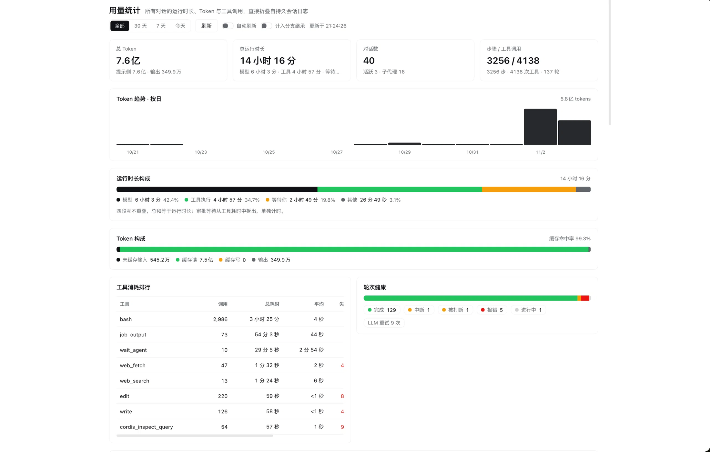

# @echovic/dsh-usage-stats

[](https://github.com/echoVic/dsh-usage-stats/actions/workflows/ci.yml)
[](https://github.com/echoVic/dsh-usage-stats/releases)
[](https://github.com/echoVic/dsh-usage-stats/blob/main/LICENSE)

Conversation usage statistics for the DeepSeek Harness Web shell — a central
panel (and a matching agent tool) that answers *how much did my conversations
cost, where did the time go, and what is trending.* Per-model token accounting,
an optional user price table with a monthly budget, and a per-conversation
detail drawer are part of the v0.3 surface.



*(截图来自 v0.2；v0.3 在 Token 构成下方新增模型用量表，卡片区新增预计费用，点击任意对话行打开详情抽屉。)*

## What it measures

Every figure is folded from the durable Session event log — the only source of
truth — and deliberately mirrors the accounting the Harness itself shows, so
the panel cannot disagree with a conversation's own usage pill:

| Figure | Definition |
|---|---|
| Token buckets | `assistant/message` / `assistant/attempt` usage, with a same-turn/same-step sample *replacing* the earlier one and `llm/retry-started` closing the replacement slot, so retried attempts add their own consumption. `inputTokens` is the uncached prompt bucket (the `tokenUsage` projection's convention); cache read/write are separate buckets. |
| Total tokens | uncached input + cache read + cache write + output |
| Cache hit rate | cache read ÷ prompt-side total |
| Runtime | wall-clock `turn/start` → `turn/end` spans, clipped to the selected range; an in-flight live turn counts up to now |
| Model time | `step/start` → `assistant/message` (a cancelled step contributes none) |
| Tool time | `tool/call` → matching `tool/result` by call id, as an **interval union** so parallel calls are not double counted |
| Human wait | `approval/asked` → `approval/decided` plus the whole duration of `ask_user_question` calls; approval waits that sit inside a tool interval are moved from tool time to human time |
| Other | the remainder after the three segments — queueing, retry backoff, gaps |
| Steps / turns | one per `step/end`; turns counted per `turn/start` |
| Tool ranking | per call id: execution time (minus human wait), calls, error results |
| Turn health | `turn/end.reason` histogram plus `llm/retry` count |
| Trend | turns bucketed by end time into local days (`all`/`30d`/`7d`) or hours (`1d`) |

The four runtime segments never overlap and always sum to the runtime: the fold
keeps each interval list and the report takes interval unions, because tools
run in parallel and an approval wait sits inside the tool call that asked for
it.

**Forked conversations**: a fork's inherited prefix was consumed in the parent,
so it is excluded from every total by default (the row still shows it as
`继承 X`, and the "计入分支继承" switch includes it). A *resumed* (not seeded)
session folds its whole log — that prefix is its own history.

## Cost and budget (optional, user-supplied prices)

The Harness log carries no prices, so cost is never invented: the plugin ships an
**example** table and only shows money once you fill real numbers.

```sh
cp prices.example.json ~/.dsh/usage-stats/prices.json
# or point the plugin elsewhere:
#   DSH_USAGE_STATS_PRICES=/path/to/prices.json
```

```json
{
  "currency": "CNY",
  "budget": { "monthly": 100 },
  "prices": {
    "deepseek-official/deepseek-flash": {
      "input": 0.5, "cacheRead": 0.1, "cacheWrite": 0.5, "output": 2.0
    },
    "deepseek-official/*": { "input": 0, "cacheRead": 0, "cacheWrite": 0, "output": 0 }
  }
}
```

- **Units**: price per **1 million tokens**, per bucket. `input` is the uncached
  prompt bucket, `cacheRead`/`cacheWrite` are the cache buckets, `output` is
  completion. Route precedence is `provider/model` → `provider/*` → `*/*` → `*`.
- **Partial cost is explicit**: a model without a price still reports tokens; it
  appears in `costing.unpricedModels`, the panel footer says how many models are
  unpriced, and its row cost shows `—` rather than a fake zero.
- **Budget**: `budget.monthly` in `currency`. Month-to-date cost is computed from
  the whole corpus regardless of the panel's selected range, and at 80% / 100%
  the panel shows a warning / error banner. The agent tool reports the same
  month-to-date figure.
- The file is re-read when its mtime changes; a malformed file degrades to
  "unconfigured" with the parse error surfaced in the payload.

There is still no hard-coded price table: numbers differ per account and change
over time, so the panel treats your table as the only source of truth.

## Architecture

```
package.json          dsh.bundle.patch + dsh.client { platform: web }
cordis.patch.yml      inserts the one Loader row ("usage-stats")
lib/aggregate.js      pure folds: events → per-turn records → range report
lib/index.js          Host half: scans the corpus, serves the route, registers the tool
lib/client.js         browser half: sidebar rail icon + central "main" panel
test/                 aggregate, route and browser-composition tests
```

**Host half** (`lib/index.js`):

- enumerates the logical corpus with `ctx.sessionQuery.listSessions()`;
- folds live sessions from memory (`ctx.sessions.get(id).snapshotEvents()`),
  persisted sessions through `sessionQuery.readSession(id)`;
- reuses a persisted session's per-turn analysis until its
  `sessionPersistence` revision changes, and serves the whole corpus from a
  short-lived TTL cache (15 s; `DSH_USAGE_STATS_TTL_MS` overrides it) with
  single-flight behind it. Range/inherited switches re-assemble the report
  from the cached corpus without re-reading logs;
- registers `GET /api/usage-stats.summary` through
  `ctx.connection.fetch.register`, inside the connection service's browser
  authentication fence — a same-origin `fetch` from the page is already
  authorised;
- registers the `conversation_usage` agent tool on the same corpus, so the
  panel and the agent read identical numbers.

Failure isolation: one unreadable/corrupt session becomes an entry in `errors`
and a warning row in the panel; the rest of the corpus still renders.

**Browser half** (`lib/client.js`):

- two slot registrations under one id (`usage-stats`):
  `sidebar.panellist` (the rail icon) and `main` (the central panel the sidebar
  addresses by that id);
- range control, auto refresh, inherited-prefix switch, token trend, four-way
  runtime split, tool ranking, turn health, sortable/searchable per-conversation
  table; clicking a conversation opens it through
  `ctx.get('uiWorkspace').openSession`;
- plain JS, no bundler; only `react` is required — no
  `@deepseek-ai/dsh-client-*` module import, which would blank the slot on
  drift;
- styles are inline and use only `--dsw-alias-*` theme tokens;
- all visible text goes through the Client locale service (zh + en);
- if the running Host half still serves the v1 payload (it needs an app
  restart to load new Host code), the panel renders the v1 cards/table with a
  restart notice instead of crashing on missing v2 fields.

## Route contract

```
GET /api/usage-stats.summary
    ?range=all|30d|7d|1d        (default all)
    &inherited=1                (include a fork's inherited prefix; default off)
    &offset=<minutes east UTC>  (local day/hour buckets; default 0)
    &force=1                    (bypass the corpus TTL cache)
→ 200 { ok, version: 3, cached, cacheAgeMs, ttlMs, generatedAt, scanMs,
        range, includeInherited, offsetMinutes,
        scope: { listed, analyzed, failed, live, subagents },
        pricing: { configured, currency, budgetMonthly, source, updatedAt, error },
        costing: { configured, currency, budgetMonthly, monthTokens, monthCost,
                   budgetRatio, unpricedModels: [ 'provider/model', … ] },
        totals: { sessions, liveSessions, subagentSessions,
                  runTimeMs, modelMs, toolMs, humanWaitMs, otherMs,
                  turns, steps, toolCalls, retries, userMessages,
                  assistantMessages,
                  tokens { input, output, cacheRead, cacheWrite, prompt, total },
                  cacheHitRate, cost, monthTokens, monthCost,
                  inherited { tokens, runTimeMs, turns, steps },
                  firstActivityAt, lastActivityAt },
        sessions: [ { id, title, createdAt, lastActiveAt, live, parentSession,
                      origin, delegationDepth, isSeeded, cwd, workspace,
                      agentPreset, eventCount, runTimeMs, modelMs, toolMs,
                      humanWaitMs, otherMs, turns, steps, toolCalls, retries,
                      userMessages, assistantMessages, tokens, cacheHitRate,
                      cost, unpriced, models, tools, turnEnds, inherited } ],
        trend: { unit: 'day'|'hour', buckets: [ { start, tokens, runTimeMs,
                  steps, toolCalls, cost, sessions } ] },
        tools: [ { name, calls, ms, errors } ],
        models: [ { provider, model, calls, tokens, cacheHitRate, cost } ],
        turnEnds: { completed, aborted, interrupted, error, maxTokens,
                    blocked, forked, other, open },
        errors: [ { sessionId, message } ], partial }

Per-session `tools` are ranked by execution time; `models` carry the same
token/cost shape as the global list. Unpriced routes keep `cost: null`.
→ 405 non-GET · 503 { ok: false, error }     (e.g. no sessionQuery service)
```

## Agent tool

`conversation_usage` takes
`{ top?: 1–20 (default 5), range?: 'all'|'30d'|'7d'|'1d', inherited?: boolean, refresh?: boolean }`
and returns the totals (with the runtime split, per-model tokens, turn health
and the estimated cost / month-to-date budget), the highest-consumption
conversations and the costliest tools, with the omitted count made explicit.
Read-only.

## Install

```js
plugin_manager({ action: "install_bundle", target: "@echovic/dsh-usage-stats@0.2.0" })
// or, with the desktop app fully quit:
// dsh plugin --profile desktop add @echovic/dsh-usage-stats@0.2.0
```

The browser half hot-reloads on save. **A change to the Host half
(`lib/index.js`, `lib/aggregate.js`) needs one application restart**, because
Host modules are not hot-replaced; until then the panel shows the restart
notice and the v1 layout. The same restart is what activates a newly installed
Host version.

## Test

```sh
cd <checkout>
npm test
```

- `test/aggregate.test.mjs` (18) — the folds against synthetic event logs: the
  four-way split (including parallel tools and approval-inside-tool), token
  replacement/retry semantics, per-route token attribution, the price table and
  wildcard resolution, range-independent month-to-date cost, turn endings, open
  turns, range clipping, local day/hour trend buckets, per-session tool/turn
  detail, and the inherited-prefix mode;
- `test/route.test.mjs` (13) — `apply()` registration, the Fetch handler,
  range/inherited parameters, the price-file loader (configured, malformed),
  the corpus TTL cache, revision-aware per-session reuse, failure isolation and
  the agent tool;
- `test/client.test.mjs` (8) — boots the real browser module in a `vm` with a
  stateful React double, renders the full v3 dashboard in zh and en, opens the
  detail drawer by clicking a conversation row, checks the v2-payload upgrade
  notice, and renders the legacy v1 payload with its restart notice, asserting
  both slot registrations, complete locale dictionaries and theme-token-only
  colors.

## Known limits

- Token totals only count usage the provider reported in the log; sessions from
  providers that omit usage contribute zeros.
- Cost is an estimate from *your* price table, not a bill: unpriced models are
  excluded from money figures (and reported as unpriced), and the month figure
  is local-calendar based.
- Runtime is turn wall time — it includes human waits and queueing; the split
  separates the human part explicitly.
- `tools[].ms` is summed per-call execution time (workload), so parallel tool
  calls may sum past the wall-clock tool segment.
- The panel is a snapshot; a live conversation's last flush may trail by up to
  the cache window unless Refresh is pressed.
- Local day/hour buckets need the browser's timezone offset; a page that cannot
  report one gets UTC buckets.


## Published package

- repository: https://github.com/echoVic/dsh-usage-stats (tags: v0.2.0)
- npm: https://www.npmjs.com/package/@echovic/dsh-usage-stats
- install from npm: `plugin_manager({ action: "install_bundle", target: "@echovic/dsh-usage-stats@0.2.0" })`
- install from git: `plugin_manager({ action: "install_bundle", target: "github:owner/repo#v0.2.0" })`
  (any https git URL works too; the repository root must be this package)
- the bundle ships the Host half, the Web client half, the Loader patch, both
  locale files and the icon; there are no runtime dependencies and no build
  step.
- the Host half runs with the application's local permissions, so read a
  third-party bundle before installing it.

## License

[MIT](https://github.com/echoVic/dsh-usage-stats/blob/main/LICENSE) © 2026 [echovic](https://github.com/echoVic)
