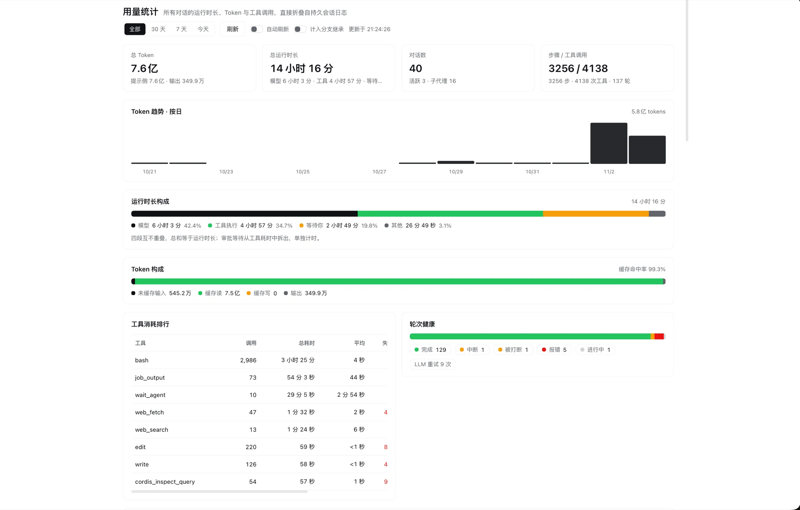

# @echovic/dsh-usage-stats

[](https://github.com/echoVic/dsh-usage-stats/actions/workflows/ci.yml)
[](https://github.com/echoVic/dsh-usage-stats/releases)
[](LICENSE)

[简体中文](README.zh-CN.md) | English

Conversation usage statistics for the DeepSeek Harness Web shell: a central panel (and a matching agent tool) that answers *how much did my conversations cost, where did the time go, and what is trending*. It covers per-model token accounting, an automatically fetched official price table with peak/off-peak billing and a monthly budget, Search and Fetch per-request costs, and a per-conversation detail drawer.



## What it measures

Every figure is folded from the durable Session event log, the only source of truth, and mirrors the Harness's own usage pill:

| Figure | Definition |
|---|---|
| Token buckets | Prompt (uncached), cache read, cache write and output tokens from `assistant/message` and `assistant/attempt`; a retried attempt adds its own consumption |
| Total tokens | Uncached input + cache read + cache write + output |
| Cache hit rate | Cache read ÷ prompt-side total |
| Runtime | Wall-clock `turn/start` → `turn/end` spans, clipped to the selected range |
| Model time | `step/start` → `assistant/message` |
| Cost and tools | Estimated cost per model and per tool, plus a per-conversation detail drawer |

## Cost and budget

- **Official prices, fetched**: the host fetches and parses the DeepSeek docs page by default (CNY, or USD with `DSH_USAGE_STATS_CURRENCY=USD`), caches it for 24 hours, and falls back to the last cache and then the bundled `official-prices.json`. Optional overrides live in `$DSH_HOME/usage-stats/prices.json`.
- **Provenance is reported**: the payload and footer say whether prices came from the live page, the cache, the bundled snapshot or a manual file.
- **Peak and off-peak**: each usage sample is classified by its timestamp; peak is weekdays 09:00–12:00 and 14:00–18:00 China time, off-peak is half price, and Chinese statutory holidays are treated as weekdays.
- **Search and Fetch**: Search API requests are counted from the log and billed per 1,000 successful requests at the official rate; `web_fetch` is unbilled by default because the shipped provider fetches locally, and `services.fetch.billed` opts in for a billable provider.
- **Budget**: `budget.monthly` drives the 80% warning and the over-budget banner; month-to-date cost is always computed over the whole corpus. Unpriced models still report tokens and are listed as unpriced instead of showing a fake zero.

## Agent tool

`conversation_usage` takes `{ top?: 1–20 (default 5), range?: 'all'|'30d'|'7d'|'1d', inherited?: boolean, refresh?: boolean }` and returns totals (runtime split, per-model tokens, turn health, estimated cost and month-to-date budget), the highest-consumption conversations and the costliest tools. It is read-only and reads the same corpus as the panel.

## Install

```js
plugin_manager({ action: "install_bundle", target: "@echovic/dsh-usage-stats@0.7.0" })
// or, with the desktop app fully quit:
// dsh plugin --profile desktop add @echovic/dsh-usage-stats@0.7.0
```

The browser half hot-reloads on save. A change to the host half (`lib/index.js`, `lib/aggregate.js`) needs one application restart, because host modules aren't hot-replaced; until then the panel shows the restart notice and the v1 layout.

## Architecture

```
lib/aggregate.js      pure folds: events → per-turn records → range report
lib/pricing.js        official-page parser, cache, bundled fallback, overrides
official-prices.json  bundled snapshot of the official table
lib/index.js          host half: scans the corpus, serves the route, registers the tool
lib/client.js         browser half: sidebar rail icon + central "main" panel
```

The host registers `GET /api/usage-stats.summary` inside the connection service's browser-authentication fence, reuses a persisted session's analysis until its revision changes, and serves the corpus from a 15-second TTL cache (`DSH_USAGE_STATS_TTL_MS` overrides it). One unreadable session becomes an `errors` entry and a warning row; the rest still renders. The client is plain JS with only `react` required, uses `--dsw-alias-*` tokens for colour and the client locale service for every string, and renders the v1 payload with a restart notice when the host is older.

## Test

```sh
npm test
```

Four suites cover the folds against synthetic event logs, official-page parsing and the pricing ladder, the route and `apply()` registration, and the browser module in a `vm` with a React double in both languages.

## Known limits

- Token totals only include usage a provider reported; providers that omit usage contribute zeros.
- Cost is an estimate, not a bill; discounts, private pricing or a docs change between fetches can differ, and holidays are not modelled.
- A `web_search` call that fails late can under-count requests it already issued, and requests without a matching call are not billed.
- Runtime is turn wall time, including human waits and queueing; the split calls the human part out explicitly.
- The panel is a snapshot; a live conversation's last flush may trail by up to the cache window unless you refresh.

## License

[MIT](LICENSE) © 2026 [echovic](https://github.com/echoVic)
