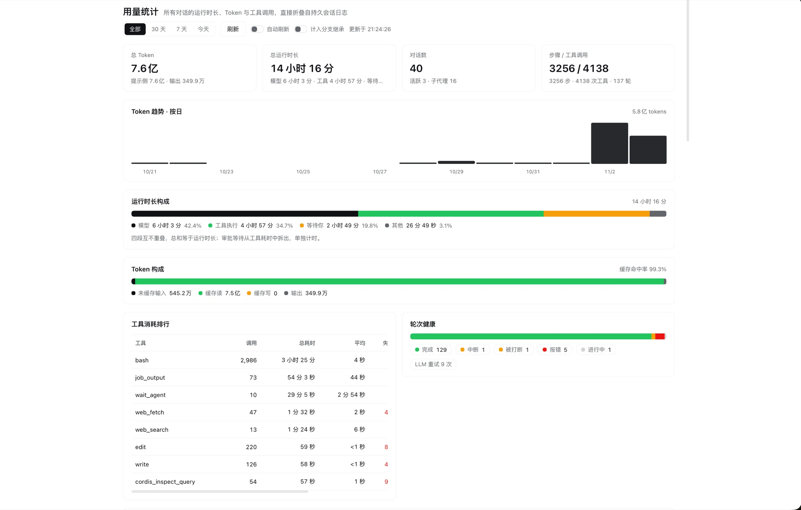

# @echovic/dsh-usage-stats

[](https://github.com/echoVic/dsh-usage-stats/actions/workflows/ci.yml)
[](https://github.com/echoVic/dsh-usage-stats/releases)
[](LICENSE)

[English](README.md) | 简体中文

DeepSeek Harness Web 端的对话用量统计：一块中央面板，外加一个对应的 Agent 工具，回答「这些对话花了多少钱、时间花在哪里、趋势如何」。包括按模型的 token 记账、自动抓取的官方价格表与峰谷计费、月度预算、Search / Fetch 按次计费，以及每段对话的详情抽屉。



## 统计什么

每个数字都从可持久化的 Session 事件日志折叠出来——那是唯一的事实来源——并且刻意与 Harness 自己显示的 usage 保持一致：

| 指标 | 定义 |
|---|---|
| Token 分桶 | 来自 `assistant/message` 和 `assistant/attempt` 的未缓存 prompt、缓存读、缓存写和输出；重试的尝试会各自累加 |
| 总 Token | 未缓存输入 + 缓存读 + 缓存写 + 输出 |
| 缓存命中率 | 缓存读 ÷ prompt 侧总量 |
| 运行时长 | `turn/start` → `turn/end` 的墙钟区间，按选中范围裁剪 |
| 模型耗时 | `step/start` → `assistant/message` |
| 费用与工具 | 按模型、按工具估算的费用，以及每段对话的详情抽屉 |

## 费用与预算

- **自动获取官方价格**：Host 默认抓取并解析 DeepSeek 文档页（人民币，设 `DSH_USAGE_STATS_CURRENCY=USD` 用美元），缓存 24 小时，失败时依次回落到上次缓存和内置的 `official-prices.json`。可选的覆盖写在 `$DSH_HOME/usage-stats/prices.json`。
- **来源可见**：返回值和页脚都会说明价格来自实时页面、缓存、内置快照还是手动文件。
- **峰谷计费**：每个用量样本按时间戳归入峰谷；高峰是工作日北京时间 09:00–12:00 和 14:00–18:00，低谷半价；法定节假日按工作日处理。
- **Search 与 Fetch**：Search API 请求从日志统计，按官方每 1,000 次成功请求计费；内置的 `web_fetch` 走本地 HTTP，默认不计费，使用可计费的 Fetch Provider 时用 `services.fetch.billed` 打开。
- **预算**：`budget.monthly` 驱动 80% 提醒和超预算横幅；月度累计始终按整个语料计算。没有价格的模型仍显示 token，并标为「未定价」，而不是显示假的 0。

## Agent 工具

`conversation_usage` 接受 `{ top?: 1–20（默认 5）, range?: 'all'|'30d'|'7d'|'1d', inherited?: boolean, refresh?: boolean }`，返回总量（运行时长构成、按模型 token、轮次健康、预估费用和月度预算）、消耗最高的对话和最贵的工具。它只读，读的是和面板相同的一份语料。

## 安装

```js
plugin_manager({ action: "install_bundle", target: "@echovic/dsh-usage-stats@0.7.0" })
// 或者，在完全退出桌面端后：
// dsh plugin --profile desktop add @echovic/dsh-usage-stats@0.7.0
```

浏览器端保存即热更新。Host 端（`lib/index.js`、`lib/aggregate.js`）的改动需要重启一次应用，因为 Host 模块不会热替换；重启前面板会显示重启提示和 v1 布局。

## 实现

```
lib/aggregate.js      纯折叠：事件 → 每轮记录 → 区间报告
lib/pricing.js        官方页面解析、缓存、内置回落和用户覆盖
official-prices.json  官方价格表的内置快照
lib/index.js          Host 端：扫描语料、提供路由、注册工具
lib/client.js         浏览器端：侧栏图标和中央面板
```

Host 在连接服务的浏览器认证边界内注册 `GET /api/usage-stats.summary`，持久化的会话在 revision 变化前复用分析结果，整个语料走 15 秒 TTL 缓存（可用 `DSH_USAGE_STATS_TTL_MS` 调整）。一个读不出的会话只会变成 `errors` 条目和一行警告，其余照常渲染。客户端是普通 JS，只依赖 `react`，颜色只用 `--dsw-alias-*` token，所有文案走 client locale（中英），Host 较旧时渲染 v1 数据并提示重启。

## 测试

```sh
npm test
```

四组测试覆盖：对合成事件日志的折叠、官方页面解析与价格回退链、路由和 `apply()` 注册，以及在 `vm` 里用 React 替身渲染中英文浏览器模块。

## 已知限制

- Token 总量只统计 Provider 上报的用量；不上报用量的 Provider 计为 0。
- 费用是估算不是账单；折扣、私有价格或两次抓取之间的文档变化都可能不同，节假日也没有建模。
- 晚失败的 `web_search` 调用可能少算它已经发出的请求；没有匹配调用的请求不计费。
- 运行时长是轮次墙钟时间，包含人工等待和排队；构成拆分里会把人工部分单独列出。
- 面板是快照；正在进行的对话最后一次刷新可能滞后一个缓存窗口，除非手动刷新。

## 许可

[MIT](LICENSE) © 2026 [echovic](https://github.com/echoVic)
